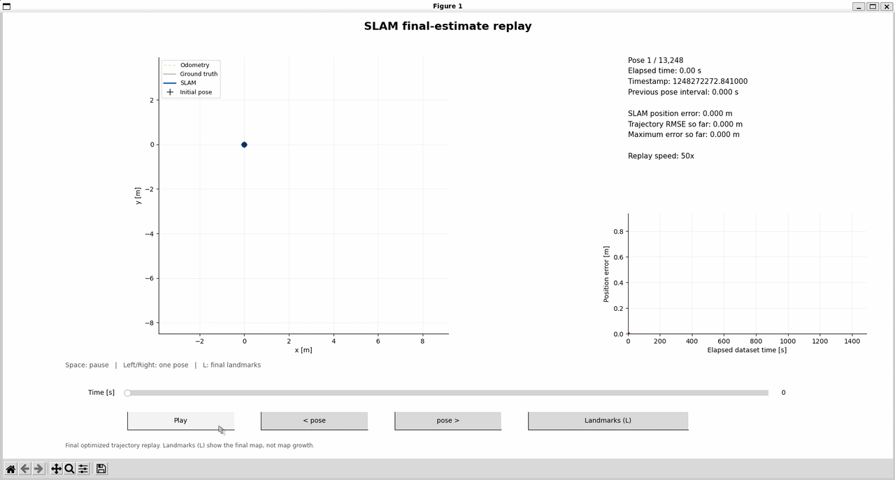

# 2D Landmark Graph-SLAM

I built an incremental graph-based SLAM backend in C++ using GTSAM/iSAM2 and wrote the dataset-processing and keyframe logic in `main_keyframes.cpp`. The input is UTIAS MRCLAM Dataset 1, which has separate timestamps for odometry records and landmark observations. My first approach was to create a pose for every odometry record and split the motion between records whenever an observation arrived, so each observation would have a pose at its own timestamp. That did not give me the result I wanted: I ended up with far too many poses and a very jagged trajectory. I then changed the processing to accumulate odometry between observation frames and send that motion to the backend when processing the next frame. This improved the result, but long gaps without observations meant that a lot of motion was still being combined into one update. The current version also adds intermediate odometry-only poses during those gaps, even when there are no landmark observations.

To see what was going wrong more clearly, I then asked AI to write the result export and an interactive Python visualization. The export, online trajectory logging, visualization, and diagnostic script were written entirely by AI. These tools let me compare SLAM with odometry and ground truth, inspect the error over time, and go back to the C++ code with a clearer idea of what needed changing. 

This is the first working version. There are still occasional jumps in the estimated trajectory, and I plan to keep improving it.



Blue: SLAM · Black: ground truth · Yellow: odometry.
Playback of the final optimized trajectory.

## What the project does

The backend uses a prior on the initial pose, odometry factors between poses, and bearing–range factors between poses and landmarks. iSAM2 updates the estimates as new data is added.

Landmark IDs come from the dataset's barcode mapping. Observations of other robots are excluded. There is no geometric data association in this version.

The viewer shows:

- **Blue:** the SLAM trajectory.
- **Black, faded:** ground truth.
- **Yellow, faded:** odometry alone.

It also shows position error over time, RMSE so far, and the largest position error so far. Ground truth is interpolated at the trajectory timestamps, and the trajectories are aligned at their initial position and heading. Ground truth is only used for evaluation and visualization, not by the SLAM backend.

Use **Space** to pause or resume, **Left/Right** to step through poses while paused, the **slider** to move through time, and **L** to show or hide the final landmark map.

## Running it

I developed this on Ubuntu under WSL. You need a C++17 compiler, CMake 3.16 or newer, GTSAM, and Python 3 with NumPy and Matplotlib. ROS is not required. GTSAM must be installed somewhere CMake can find it.

### Prepare the dataset

Download **Dataset 1** from the [UTIAS MRCLAM page](https://asrl.utias.utoronto.ca/datasets/mrclam/). Put these files directly in a `dataset/` folder at the repository root:

- `Barcodes.dat`
- `Robot1_Odometry.dat`
- `Robot1_Measurement.dat`
- `Robot1_Groundtruth.dat`
- `Landmark_Groundtruth.dat`

The dataset is not included in the repository. 

For the current demo, I changed the local barcode mapping to exchange landmark assignments 11 and 17 - I found them to be misslabeled in my testing. To reproduce the same result, use the same adjustment in `Barcodes.dat`. This is a change to my local copy, not a claim that every copy of the original dataset needs correcting.

### Build and process the data

From the repository root:

```bash
cmake -S . -B build
cmake --build build -j2
./build/slam_main
```

Run the executable from the root so it can find `dataset/`. It generates:

- `trajectory.csv`: odometry and the final optimized SLAM trajectory.
- `online_trajectory.csv`: pose estimates recorded after incremental updates.
- `landmarks.csv`: the final estimated landmark positions.

### Open the visualization

Set up the Python environment:

```bash
python3 -m venv .venv
source .venv/bin/activate
python -m pip install numpy matplotlib
```

Replay the final optimized trajectory:

```bash
python plot_slam.py --speed 20
```

The speed is dataset seconds per second of playback. This replay shows the final optimized poses, not the history of the optimizer's corrections.

To replay the estimates recorded during processing instead:

```bash
python plot_slam.py --trajectory online_trajectory.csv --speed 20
```

To follow new estimates while the backend is running, use another terminal with the Python environment activated:

```bash
python plot_slam.py --live
```

Live mode follows the logged poses. It does not redraw corrections to older poses, and the optional landmark overlay is the final exported map, not a live map. Close the viewer and start it again for a new backend run.

The interactive viewer needs a graphical desktop. For a static image or numerical diagnostics:

```bash
python plot_slam.py --static
python diagnose_slam.py
```

The dataset, build folders, Python environment, and generated outputs are ignored by Git. Run the backend to generate the CSV files before opening the viewer.

## What I want to improve next

The trajectory is much better than in my earlier attempts, but it still makes sudden corrections sometimes, especially after gaps between observations. So far I have focused on one robot in one dataset.

Next I want to understand the remaining jumps, tune the noise models more systematically, and test on other sequences. I also want to make dataset paths and parameters easier to configure.

## Links

- [UTIAS MRCLAM dataset](https://asrl.utias.utoronto.ca/datasets/mrclam/)
- [GTSAM](https://gtsam.org/)
